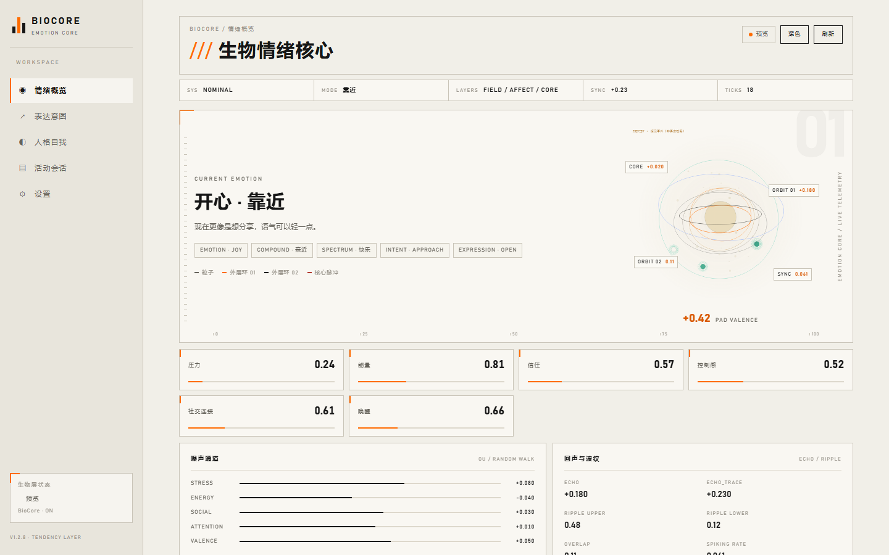

# 安全警告

> **公开部署建议保持 `safety_enabled=true`**（新装默认开启；私人使用可关）。它控制敏感掩码、跨会话隔离、低置信拒答与投毒过滤；关闭时 Dashboard/启动日志会提示风险。旧配置保留用户已保存值。

# BioCore · 拟态生物情绪核心

`BioCore` 是面向 AstrBot 的**本地拟态生物情绪核心**：读取当前人设并维护数值档案，在对话过程中模拟情感、压力、能量、信任、记忆事件和关系轨迹，再由解释层转成简短的表达意图注入 LLM 请求。

这里的“拟态”指**行为层模拟**：模仿生物情绪系统的功能结构，不声称复刻神经元、内分泌或意识。

它默认不主动生成回复、不替换人设、不改写聊天历史，也不代表临床诊断、真实意识或现实因果；它只是一个可观察、可调整的本地状态与表达提示层。

- 插件名：`astrbot_plugin_biocore`
- 插件 ID：`Johnhmzm/astrbot_plugin_biocore`（`metadata.author/name`）
- 当前版本：以 `metadata.yaml` 为准（当前 `1.3.4`）
- 作者：`Johnhmzm`
- GitHub：<https://github.com/Johnhmzm/astrbot_plugin_biocore>
- Gitee 镜像：<https://gitee.com/johnhim/astrbot_plugin_biocore>
- Logo：`logo.png`（256×256）



## 拟态机制：模仿生物的什么

BioCore 的“拟态”是**行为与功能层**的模仿：参考生物情绪系统如何组织——事件先被评价，情绪有强度和走向、会回落，身体状态参与调节，重要经历被巩固和遗忘，关系在互动中积累信任、经历冲突并修复；再用可计算的状态把这套过程稳定地跑起来，最后由解释层转成简短的表达意图。

它模仿的是功能结构与可观察行为；拟态范围以对话表达所需的粒度为界。

### 模仿的生物行为与机制

| 生物行为/机制 | BioCore 的拟态机制 | 拟态局限 |
|---|---|---|
| 核心情感（PAD） | 用快乐—唤醒—掌控感三条连续轴描述当前心情，并让心情随事件、记忆与身体状态移动 | 连续数值级拟态：覆盖日常对话所需的情绪方向、强度与掌控感粒度。 |
| 认知评价 | 事件先做相关性、利害、应对与归因判断，再把评价转成情绪变化 | 参数化规则级拟态：覆盖目标相关性、利害、应对、归因四类常见评价。 |
| 情绪频谱 | 同时保留多种情绪的强度与共存关系，并给出整体走向 | 标签与强度级拟态：覆盖多情绪共存、强度与整体走向。 |
| 情绪衰减与恢复 | 每种情绪按自身节奏回落到基线，压力、能量与睡眠状态参与恢复速度 | 曲线级拟态：覆盖分钟到小时尺度的回落与恢复节奏。 |
| 稳态调节（设定点与驱动） | 维护能量、社交、安全、好奇等驱力的设定点；偏离时产生需求与压力，推动下一次表达或行动倾向 | 功能代理级拟态：覆盖“偏离—需求—调节”闭环，以驱力与需求粒度呈现。 |
| 内感受 | 把身体与情绪数值转成“累、渴、紧绷、想说话”等内部感受，并影响表达长度与语气 | 可读文本级拟态：以内部感受描述和阈值粒度影响表达。 |
| 压力与恢复（异稳态） | 急压力回落，长期压力缓慢累积为负担，休息与睡眠帮助恢复，形成压力记忆 | 慢变量级拟态：覆盖压力累积、恢复与负荷记忆的时间尺度。 |
| 趋近、回避与停顿 | 综合关系、压力、能量与情境，把状态转成靠近、退开或先观察的行动倾向 | 行动倾向级拟态：覆盖靠近、退开、先观察三种表达/行动倾向。 |
| 记忆巩固 | 高重要性事件优先归档、总结，形成可检索的事件与记忆条目 | 行为级拟态：覆盖重要性筛选、归档与总结粒度。 |
| 遗忘 | 边缘细节随时间淡出，低价值内容逐步减少，核心摘要保留 | 参数级拟态：覆盖细节淡出与摘要保留的时间曲线。 |
| 回忆与再激活 | 被召回的内容参与当前状态，并带情绪色彩重新影响判断与表达 | 检索级拟态：覆盖召回内容对当下状态的再激活。 |
| 关系：信任/亲近/冲突/修复 | 按互动累积信任、亲近、冲突与修复轨迹；冲突后通过修复动作回到稳定 | 关系状态级拟态：覆盖信任、亲近、冲突、修复的可观察轨迹。 |
| 依恋与缺席 | 对重要对象形成较稳定的联系；长期缺席带来状态变化，回归时出现重连倾向 | 简化模型级拟态：覆盖稳定联系、缺席反应与重连。 |
| 自我叙事 | 把近期经历与关系变化整合成连续的自我描述与自我摘要，支撑长期一致性 | 文本与数值级拟态：覆盖叙事自我的连续性粒度。 |
| 解释层 | 把数值状态转成简短的表达意图注入对话请求，回复后的可观察反馈回流状态 | 注入级拟态：覆盖状态到表达意图的通道，回复反馈回流状态。 |

## 功能

- **一次性人设编译（可选）**：开启 `persona_compile` 且配置 Provider 时，首次运行读取 AstrBot 当前人设并编译为数值档案缓存，之后不再每轮解析人设文本；该 LLM 功能默认关闭，关闭时保留已有/默认档案。
- **拟态状态**：维护 valence / arousal / dominance / social / trust / stress / energy 等连续状态，并带衰减、稳态和基础动力学。状态更新是确定性的，LLM 不直接写状态。
- **解释层**：唯一负责把数值状态转成 LLM 可读的紧凑表达意图（`[BC]`）；回复中的模型输出由解释层校验后再交给生物层。
- **记忆与事件**：本地记忆索引、记忆巩固、重要事件归档、事件总结和事件时间线；支持旧数据兼容与回退。
- **关系与用户模型**：按会话/用户维护信任、亲近、冲突、修复等关系轨迹，以及自我模型摘要。
- **Dashboard**：在 AstrBot WebUI 内查看情绪概览、表达意图、人格自我、活动会话/记忆、设置和备份。
- **可选 LLM 总结**：事件总结、记忆总结等 LLM 辅助功能可以关闭；关系洞察、日记、幽默提示等提案型功能默认关闭。关闭 LLM 总结后，插件仍可依靠本地确定性逻辑运行。

## 安装

### 从 AstrBot 插件市场安装

上架后，在 AstrBot WebUI → 插件市场搜索 **BioCore 拟态生物情绪核心** 并安装。

### 从 GitHub 安装

在 AstrBot WebUI → 插件管理使用仓库地址：

```text
https://github.com/Johnhmzm/astrbot_plugin_biocore
```

也可以手动克隆到 AstrBot 插件目录，安装后重载 AstrBot：

```text
AstrBot/data/plugins/astrbot_plugin_biocore_standalone/
```

### 依赖与要求

- AstrBot：`>=4.16,<5`
- 平台：`aiocqhttp`
- Python 依赖：无第三方包；使用 AstrBot 提供的模块和 Python 标准库
- 可选：本地图片识别需要自行配置 `llama-server` 和 VLM 模型路径（见下方配置），留空则不启用

## 更新

市场安装或 GitHub 仓库安装时，优先使用 AstrBot 的更新按钮；ZIP 上传安装的更新按钮可能不可用，需要先切换/绑定市场源或覆盖安装一次。

更新不会删除持久化数据；请勿勾选“删除数据”。版本号以 `metadata.yaml` 为准，详细更新记录见 [CHANGELOG.md](CHANGELOG.md) 与 [UPDATE.md](UPDATE.md)。

## 配置

在 **AstrBot WebUI → 插件 → BioCore → 配置** 中调整。常用项：

| 配置项 | 默认值 | 说明 |
|---|---|---|
| `safety_enabled` | `true` | 新装默认开启；公开/多用户部署建议保持 `true`（敏感信息掩码、跨会话限制、低置信记忆拒答）；私人使用可手动关闭 |
| `we_memory_enabled` | `false` | 共同记忆/多用户共享记忆默认关闭；仅在明确需要时开启 |
| `llm_only_reply_summary` | `true` | 严格模式：LLM 仅用于回复与总结，其他提案型功能保持关闭 |
| `event_summary` / `memory_summary` | 开启 | 事件/记忆总结；可在 LLM 功能开关中关闭 |
| 其他 LLM 功能 | 默认关闭 | `relationship_impression`、`insight`、`diary`、`humor_hint` 等默认不启用 |
| `bc_prompt_mode` | `telemetry` | 默认注入紧凑状态 telemetry；切换到 `semantic` 可查看自然语言 brief |
| `summary_max_chars` | `0` | 默认不设硬上限；异常/安全场景可设置上限 |
| `image_llama_server` / `image_llama_model` / `image_llama_mmproj` | 空 | 可选本地 VLM 路径；仅本地图片识别模式，使用通用多模态 API 时留空 |
| `image_service_port` | `0` | 本地 llama-server 端口；0=不启用，仅本地 VLM 模式，不是通用 API 地址 |

Dashboard 设置页还提供 BioCore 专用 API 覆盖、记忆压缩、可视化图层、版本检查和备份。

### 最小配置清单

装好后先确认这四项，再开始聊天：

1. **人设（persona）**：AstrBot 当前人设可读；`persona_compile` 是可选项，不编译也会使用默认/已有档案。
2. **API key / provider**：主回复用宿主 LLM；事件/记忆总结、embedding、重排需要对应 provider，缺失时走确定性回退/本地排序，不阻断回复。
3. **data 目录可写**：确认 `AstrBot/data/plugin_data/astrbot_plugin_biocore_standalone/` 可写；不可写会导致状态/记忆静默降级。
4. **AstrBot 版本**：`>=4.16,<5`，平台 `aiocqhttp`；公开部署保持 `safety_enabled=true`。

## 使用

插件没有需要记忆的聊天命令；它通过 AstrBot 的 LLM 请求/响应钩子自动工作：

1. 安装并重载插件；
2. 正常与机器人对话；
3. 插件在请求中附加紧凑的生物状态表达意图，在回复后解析模型返回的标签并更新本地状态；
4. 打开 **AstrBot WebUI → 插件 → BioCore → Dashboard** 查看状态、记忆和关系。

它不会接管消息、不会自行回复、不会替换人设，也不会接管其他插件的记忆。

## 数据与隐私

持久化数据保存在 AstrBot 的插件数据目录，不在插件代码目录，也不会提交到仓库：

```text
AstrBot/data/plugin_data/astrbot_plugin_biocore_standalone/
  persona_profile.json
  states/
  memory/
  archives/events.jsonl
  archives/insights.jsonl
  users/
  self_model.json
```

- 默认不包含任何外部遥测、统计上报或下载行为。
- 只有在启用对应 LLM 功能且配置了 Provider 时，相关摘要/洞察请求才会发送给该 Provider；发送内容限于该功能所需的事件/记忆摘要，不包含完整聊天上下文。
- `safety_enabled: true` 是新装默认值；公开部署建议保持开启，私人使用可关闭，并按需配置敏感信息掩码和跨会话记忆限制。
- 更新/卸载前请备份上述数据目录。

## 平台与兼容性

- AstrBot `>=4.16,<5`
- 平台适配器：`aiocqhttp`
- 使用 AstrBot 的 `on_llm_request` / `on_llm_response` 钩子；默认不主动接管消息事件、默认不主动生成回复、不替换人设、不接管其他插件记忆
- 不依赖数据库迁移脚本；旧数据按字段缺失回退

## FAQ

**Q：为什么机器人回复看起来没有变化？**  
A：BioCore 是隐藏状态/表达意图层，不会强制生成或改写回复；它的影响取决于当前 LLM、提示和上下文，属于渐进式表达倾向，不是直接命令。

**Q：必须配置 LLM 吗？**  
A：核心状态、记忆和 Dashboard 可以在本地运行；事件/记忆总结等 LLM 辅助功能可以关闭。

**Q：会读取或上传我的聊天记录吗？**  
A：默认不上传。只有在启用具体 LLM 功能并配置 Provider 时，相关摘要请求才会发给该 Provider；本地数据保存在 `plugin_data`。

**Q：这是临床情绪诊断或真实意识吗？**  
A：不是。它是一套面向角色表达的可调数值状态模型，不提供医疗/心理诊断，也不声称真实意识或现实因果。

**Q：支持哪些平台？**  
A：当前 metadata 声明 `aiocqhttp`；AstrBot 版本要求 `>=4.16,<5`。

**Q：更新会丢数据吗？**  
A：正常市场/仓库更新不会；持久化数据在 `plugin_data`。升级前仍建议备份。

## 更新日志

- 当前版本：`1.3.4`（以 `metadata.yaml` 为准）
- 发版口径：**`1.3.4` 为发版目标；市场记录已同步为 `1.3.4`**，公开仓库与市场在发布时同步
- 详细历史见 [CHANGELOG.md](CHANGELOG.md) 与 [UPDATE.md](UPDATE.md)
- 版本更新由 AstrBot 插件市场/GitHub 源同步；市场记录版本必须与 `metadata.yaml` 一致

## 许可证

本项目采用 **GNU Affero General Public License v3.0（AGPL-3.0）**。

Copyright (C) 2026 Johnhmzm

你可以使用、修改、分发本项目，但分发或通过网络提供服务时必须按 AGPL-3.0 公开完整对应源码，衍生作品也必须继续使用 AGPL-3.0。完整条款见 [LICENSE](LICENSE) 或 <https://www.gnu.org/licenses/agpl-3.0.html>。

本项目不提供任何担保；使用前请自行评估。

## 相关链接

- GitHub：<https://github.com/Johnhmzm/astrbot_plugin_biocore>
- Gitee 镜像：<https://gitee.com/johnhim/astrbot_plugin_biocore>
- 问题反馈：<https://github.com/Johnhmzm/astrbot_plugin_biocore/issues>

## 主动行为与学习默认（review BLOCK-04/09）

- 默认不主动发送；只有 proactive_autonomy=true + proactive_send=true 且私聊才可能发送，受 30min 冷却/每日3条/0–8点静默限制。
- bio_learning 默认 true（小步长、硬边界）；需要完全冻结学习时设 bio_learning=false；/biocore learning reset 可恢复默认。
- retention_model 默认 single（1.2.98 旧指数）；power_law/multi_scale 为实验模型，A/B 后再切换。
