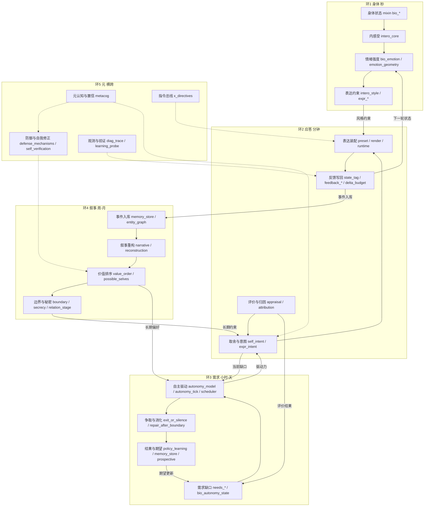

# BioCore 架构地图（ARCHITECTURE-MAP）

> 对象：`astrbot_plugin_biocore_standalone/biocore_model/`（不含 `tests/`、`__init__.py`、`backups/`）
> 快照：2026-11-02 22:55 +08:00，git HEAD `4faf941`（工作区有未提交新增；扫描期间自我层模块仍在并发落地，边界见 §9.5）
> 规模：**134 个模块**（用户口述 109；实测 134，差额为并发新增的自我/观察层模块）
> 方法：AST 级 import 解析（支持多行 import）+ 模块名全文引用扫描 + 动态加载扫描；**不运行代码、不改任何 .py**。
> 状态口径：**在用** = 有非测试静态 import；**待接线** = 0 引用但计划接线/新增未接；**疑似废弃** = 0 引用且已被替代或有内联实现（理由见 §9.3）。

## 0. 结论速览

| 层 | 模块数 | 定义（它改变什么） | 允许调用的相邻层 |
|---|---|---|---|
| L0 身体 | 35 | 只存/算连续数值，不知道语言 | 仅 L0/L1（上→下） |
| L1 记忆 | 11 | 存过去事实、可检索 | 相邻上下层 |
| L2 自我 | 19 | 做取舍（想要什么 / 更在意什么） | 相邻上下层 |
| L3 解释 | 13 | 把数值翻成语言约束与解释（含图例/预设） | 相邻上下层 |
| L4 表达 | 11 | 生成/校验/回写文本（提示词渲染与回复文本） | 相邻上下层 |
| L5 交互 | 15 | 时机与通道（要不要发、何时发、走哪条） | 相邻上下层 |
| X 交叉层 | 30 | 跨两层以上或跨 ≥2 个环的协调（回写 / 装配 / 桥接） | 任意（跨层/跨环） |
| **合计** | **134** | | |

- 状态：在用 90，待接线 32，疑似废弃 12
- 重复对：**13 对**（另有 8 对形似重复但已核查为不同职责，见 §9.2）
- 不属于任何环：**16 个**（其中多数是在用基础设施，并非死代码，见 §8.6）
- 同时服务 ≥2 个环：31 个（按新增环判据，只有 4 个属于 X，见 §7.1）

## 1. 分层口径（怎么判）

按「**它改变什么**」判层，不看文件名前缀：

1. 只改连续数值、不认识语言 → L0。
2. 只存/取过去事实，供检索 → L1。
3. 在两个可行之间做取舍（想要什么、先保哪个）→ L2。
4. 把数值/事件翻成语言约束（图例、预设、归因维度、情境摘要）→ L3。
5. 真正生成/校验/回写文本（提示词渲染、语气、切分、清洗、标签解析）→ L4。
6. 决定时机与通道（发不发、何时发、走哪个 provider/入口）→ L5。
7. 同时满足以下任两条 → **X 交叉层**：
   - 判据 1：输入来自某层、输出写到另一层；
   - 判据 2：依赖外部（宿主/模型/文件）且连接两层；
   - 判据 3：被多个层调用、自身不做业务判断；
   - 判据 4（新增，环维度）：同时服务 **≥2 个环**，且角色是合并/投影/回写而不是单一业务对象。

> 判据 4 的口径：它只是「进 X」的必要条件之一，仍需满足判据 3（自身不做业务判断）。否则 `memory_store`（服务环 2/3/4）、`needs_*`（环 3）这类有明确业务对象的模块会被吞进 X，分层就失去意义。按此口径多环模块 31 个，只有 4 个属于 X：`x_directives`、`diag_trace`、`feedback_memory`、`graph_extract`（其余保留主层清单见 §7.3）。

> 与用户口述清单的三处冲突，按判据 1/2 归 X 并在此说明：`emotion_probe`（L3 列表 vs X 例子）→ X（LLM→状态）；`state_tag`（L4 列表 vs X 例子）→ X（文本→状态）；`situation`/`layered_memory`（L3/L1 列表 vs X 例子）→ X（记忆/状态→提示词）。层内示例仅作倾向，不覆盖「输出写到另一层」的事实。

## L0 身体（只存/算连续数值，不知道语言） — 35 个

| 模块 | 一句话职责 | 输入 | 输出 | 被谁调用 |
|---|---|---|---|---|
| `attachment_regulation` | 依恋激活 + 情绪调节 + 心情基线（GAP-G 包装） | 威胁、时间、情绪 | 激活值、调节策略、心情 | —（非测试代码无静态 import） |
| `attachment_state` | 依恋激活（BIO-4） | 威胁、时间 | 依恋激活/模式 | attachment_regulation.py |
| `autonomic` | 自主神经振荡 0.1–0.3 Hz | 时间、种子 | 振荡值/阈值 | main.py |
| `bio_appraisal` | L0 评价 + 情绪分化：七维 appraisal 单源计算（ARCH-1） | 刺激/事件特征 | appraisal 七维、情绪分化 | appraisal_action.py |
| `bio_autonomy_state` | 自主就绪 mixin：确定性噪声→autonomy_state() | 状态快照 | autonomy_state 字典 | blocks.py, main.py |
| `bio_const` | 生物层常量：昼夜曲线等 | 时间 | 常量曲线值 | bio_autonomy_state.py, bio_daily.py, bio_emotion.py, bio_emotion2.py, bio_noise.py, bio_physiology2.py 等 8 |
| `bio_daily` | 日常 mixin：日报摘要、回复一致性、调节 | 当日状态序列 | daily digest 数值 | blocks.py, main.py |
| `bio_emotion` | 情绪 mixin：v/a/d/social/stress 等叶节点动力学 | 刺激、衰减参数 | 情绪维度新值 | blocks.py, main.py |
| `bio_emotion2` | 情绪 mixin#2：标签推断、模型输出应用、调节 | 维度值、模型标签 | 标签、调节后维度 | blocks.py, main.py |
| `bio_goal` | 目标 mixin：目标签名 / 证据 / 冲突 | 目标事件、进展 | goals / goal_focus / goal_conflict | blocks.py, main.py |
| `bio_identity` | 身份 mixin：身份威胁、用户反馈、信任种子 | 用户反馈事件 | identity_threat、trust 种子 | blocks.py, main.py |
| `bio_noise` | 噪声 mixin：离散噪声 tick 与先验混合 | seed、tick | noise 场 | blocks.py, main.py |
| `bio_physiology2` | 生理 mixin：昼夜/休息、异稳态负荷、反思树 | 时钟、负荷事件 | 昼夜警觉、allostatic_load | blocks.py, main.py |
| `bio_snapshot` | 快照 mixin：load_state + snapshot()，状态唯一出口 | 持久化状态字典 | snapshot() 数值快照 | blocks.py, main.py |
| `bio_state` | 状态 mixin：关系上下文 / appraisal 意图 / 记忆痕迹 / 拒绝姿态 | 快照、关系状态、记忆痕迹 | BioCore 实例属性 | blocks.py, main.py |
| `bio_tick` | 生命维护 tick：纯状态演化，无模型调用、无 IO | snapshot + 时长 | 推进后的 snapshot | main.py |
| `bio_util` | 纯工具 mixin：文本 / 向量 / 数值小工具 | 原始值 | 归一化值、文本片段 | bio_autonomy_state.py, bio_daily.py, bio_emotion.py, bio_emotion2.py, bio_identity.py, bio_noise.py 等 11 |
| `compassion_fatigue` | 共情疲劳容量：连续安慰的代价与恢复 | 连续安慰数、负性密度、空闲时长 | fatigue / empathy、档位建议 | —（非测试代码无静态 import） |
| `connection_bids` | Gottman bid / 响应性 / 信任三层 | 交互事件 | bid 记录、信任值 | —（非测试代码无静态 import） |
| `criticality` | 临界性雪崩：重尾内部事件 | seed、tick | 事件尺寸/突发 | main.py |
| `extreme_scenarios` | P2-2 极端场景守卫：八种极端情境的有界报告（测试用纯函数） | 状态字典 | 有界报告 | —（非测试代码无静态 import） |
| `frustration_curve` | Amsel 挫折曲线 + 变比强化 | 奖励历史、期待 | 挫折倍率、下次间隔 | —（非测试代码无静态 import） |
| `intero_core` | 内感受四通道（[0,1] 身体维度） | 生理量、快照 | 四通道内感受值 | bio_tick.py, regulation_loop.py, main.py |
| `mind_wander` | 空闲心智游走采样（open loop / 反刍） | 未决事项、种子 | 游走目标 | main.py |
| `mood` | 慢变量心情（BIO-4） | 情绪均值、时间 | mood{valence,arousal} | attachment_regulation.py |
| `needs_esteem` | 自尊 + 四需求（GAP-C） | 被忽视/被回应事件 | 自尊、需求值 | —（非测试代码无静态 import） |
| `needs_events` | 需求事件钩子：事件推动需求、需求偏置行为 | 交互/沉默事件 | 需求增量、行为偏置 | main.py |
| `needs_sleep` | 四需求 + 睡眠债（Williams 2007 / Borbély 1982） | 事件、时间 | 需求值、睡眠债 | bio_tick.py, needs_esteem.py |
| `noise_bank` | 噪声库：可复现事件爆发抽样 | seed/tick/salt | 噪声抽样 | main.py |
| `predictor` | 预测编码：预测下一轮状态、算惊讶度 | 上轮状态 + 本轮输入 | 预测值、surprise | main.py |
| `regulation_loop` | 内感受→调节动作选择 + 效能学习 | 内感受值、上下文 | 调节动作、效能增益 | bio_tick.py |
| `relationship_stage` | 关系阶段 / 接触频率 / 习惯化（脚本校准用） | 交互统计、时间 | 阶段、模板权重 | scripts/autonomy-calibrate.py |
| `self_esteem` | 状态自尊纯函数（BIO-1） | 旧自尊、反馈 | 新自尊 | —（非测试代码无静态 import） |
| `sleep_circadian` | Borbély 双过程昼夜 + 睡眠耦合 | 本地时间、睡眠记录 | circadian、睡眠状态 | bio_tick.py |
| `social_pain` | 关系性社交疼痛（Eisenberger） | 排斥/忽视事件 | social_pain 值 | stages.py |

## L1 记忆（存过去事实、可检索） — 11 个

| 模块 | 一句话职责 | 输入 | 输出 | 被谁调用 |
|---|---|---|---|---|
| `commitment_extractor` | 承诺抽取器：把一句话解析成 prospective 记忆行（规则式，无 LLM） | 一句话 + now | prospective 条目（her_promise/his_event + 时间） | —（非测试代码无静态 import） |
| `entity_graph` | 实体图记忆：节点 + 带类型时间边 | 实体/关系写入、查询 | 图结构、邻居 | graph_extract.py, graph_recall.py, migrate.py |
| `entity_resolve` | 实体消歧：规范化 / 相似度 / 别名合并（纯函数） | 实体名、候选集 | 规范实体、匹配分 | entity_graph.py, graph_extract.py, state_tag.py, main.py |
| `memory_dual` | 双强度记忆模型：只算强度 / 衰减，不存储 | 记忆条目、上下文匹配 | 强度、衰减 | bio_tick.py, main.py |
| `memory_forgetting` | 艾宾浩斯遗忘 + 再巩固 + 反刍内容 | 记忆强度、时间 | 保留强度、可注入项 | feedback_memory.py |
| `memory_store` | 记忆条目 SQLite 存储：写入 / 检索 / 去重 / 衰减 | 记忆条目、查询 | 检索结果、统计 | migrate.py, main.py |
| `narrative` | 自传叙事：关键事件→章节化条目 + 一致性检查 | 关键事件流 | 叙事条目、一致性 | —（非测试代码无静态 import） |
| `prospective` | 前瞻记忆：她说要问的事与提醒时点 | 承诺/用户事件 | 待触发条目、到期列表 | main.py |
| `reconstruction` | 记忆重构：每次召回给记忆加少量漂移 | 条目、当前心情 | 漂移量/方向 | —（非测试代码无静态 import） |
| `source_monitoring` | 来源监控 + 心情一致性回忆：记忆来自亲历/被告知/推断，及低心情更易召回负性记忆 | 记忆条目、元数据、当前心情 | 相信的来源、置信度、误归因概率、召回偏置 | —（非测试代码无静态 import） |
| `turn_memory` | 每轮「用了哪些记忆」回执（纯函数、无 IO） | 检索 trace | 可读回执行 | main.py |

## L2 自我（做取舍（想要什么 / 更在意什么）） — 19 个

| 模块 | 一句话职责 | 输入 | 输出 | 被谁调用 |
|---|---|---|---|---|
| `affective_labor` | 表层扮演：说的和感到的不一致所耗的能量 | 表达意图、真实状态、诚实度 | labor 成本、负荷 | —（非测试代码无静态 import） |
| `attachment_behavior` | 依恋风格→行为参数（主动/寻求/退缩 + 语气） | 风格权重 | 行为参数、语气提示 | —（非测试代码无静态 import） |
| `boundary` | 她自己的底线（区别于内容安全闸） | 关系、越界事件 | severity、阈值、动作 | repair_after_boundary.py |
| `defense_mechanisms` | 防御机制：否认/合理化/投射/置换（Vaillant 阶梯） | 负性事件、状态、自我概念 | 机制、强度、代价、自我解释 | —（非测试代码无静态 import） |
| `dissonance` | 认知失调：说到做不到的张力与缓解方式 | 立场、行为 | 张力、缓解策略 | —（非测试代码无静态 import） |
| `envy` | 嫉妒/社会比较：三级强度 + 行为倾向（探问/收敛/挑刺/压下） | 关系阶段、公平感、第三人、自我评价 | 等级、强度、行为倾向、一句理由 | —（非测试代码无静态 import） |
| `learning_probe` | 学习回路验证辅助：反馈是否真的改变后续行为（测试用纯函数） | 反馈序列、动作序列 | 重复奖励/递减 delta/响应比 | —（非测试代码无静态 import） |
| `metacog` | 元认知：有多确定、要不要补救 | 证据、guard 命中 | 置信档、动作建议 | main.py |
| `policy_learning` | 上下文 bandit 策略学习（纯函数） | 上下文、奖励 | 动作选择、状态 | learning_probe.py, main.py |
| `possible_selves` | 可能自我：她还想成为谁，差距即拉力 | 价值维度现状、目标 | 拉力、一句日志 | —（非测试代码无静态 import） |
| `regulation_strategies` | Gross 情绪调节五族策略：按效果/成本比选策略 | 状态、事件、关系 | 策略、成本、效果 | —（非测试代码无静态 import） |
| `relation_stage` | 关系阶段：陌生→稳定及匹配动作 | 互动量、自披露、修复、认识时长 | 阶段、动作 | —（非测试代码无静态 import） |
| `repair_after_boundary` | 越界后的修复序列（冷→明说→记账→翻页） | 越界事件、道歉质量、时间 | 阶段推进、debt | —（非测试代码无静态 import） |
| `secrecy` | 保守秘密：敏感度 × 关系深度 × 场合→说/瞒/软化 | 秘密条目、关系、场景 | tell/withhold/reframe、压力 | —（非测试代码无静态 import） |
| `self_intent` | 自我层：这一轮「她想要什么」的取舍 | 身体状态、需求、关系 | 意图/驱动、满足度 | main.py |
| `self_interest` | P1 self-interest accounting (task-147 core): every option has a her-si | （快照后新增，未分类） | （快照后新增，未分类） | —（非测试代码无静态 import） |
| `self_verification` | 自我验证：被误读时想纠正的冲动 | 被误读程度、关系清晰度 | 纠正强度 | —（非测试代码无静态 import） |
| `social_theory` | 自披露 / 反问 / 心智理论（GAP-E） | 关系阶段、话题 | 分享/提问概率 | —（非测试代码无静态 import） |
| `value_order` | 价值排序：两件好事冲突时先保哪个（Schwartz 十值） | 情境、价值权重 | 取舍结果、沉没成本 | —（非测试代码无静态 import） |

## L3 解释（把数值翻成语言约束与解释（含图例/预设）） — 13 个

| 模块 | 一句话职责 | 输入 | 输出 | 被谁调用 |
|---|---|---|---|---|
| `appraisal_action` | Lazarus/Scherer 评价→动作倾向 + 好奇缺口 | appraisal 七维 | 动作倾向、prompt_line | —（非测试代码无静态 import） |
| `attribution` | Weiner 因果归因：维度推断 + 情绪提示（纯函数） | 事件文本 | locus/stability/controllability | stages.py |
| `attributor` | 归因层：三维归因→情绪与「谁该负责」 | 事件、维度 | 情绪、责任分配 | —（非测试代码无静态 import） |
| `emotion_geometry` | 情绪连续空间：标签是只读描述 | 六维向量 | 标签概率、熵 | granularity.py, stages.py, main.py |
| `granularity` | 情绪粒度：六原型→二级标签 | 原型分数、上下文 | 二级标签 | —（非测试代码无静态 import） |
| `intent_render` | 意图渲染：感受→倾向约束（无数字/情绪词） | 动作/感受 | 一句倾向约束 | main.py |
| `intero_style` | 内感受→表达风格（长度/语气/主动性） | 四通道值 | 长度因子、语气 | main.py |
| `preset` | SillyTavern 式注入块：id/role/position/条件 | 状态快照 | 注入块记录 | main.py |
| `prompt_rules` | 系统提示词行为规则（由 affect 渲染） | affect、关系 | 规则文本 | runtime.py, main.py |
| `render` | 确定性渲染：telemetry/[BC]/解释三种模式的提示词文本 | snapshot、上下文 | 注入文本 | interpretation.py, main.py |
| `schema` | 数值字段单一真相源：文档与提示词图例 | 字段定义 | 图例文本、markdown 表 | runtime.py, stages.py, main.py |
| `social_repair` | 感恩 / 边界 / 共情通道 / 对话修复 / 时间感 | 事件、关系 | 修复话术片段 | —（非测试代码无静态 import） |
| `waiting_sense` | 等待感：把测量到的消息间隔翻成四类感受（平静/惦记/不安/赌气）+ 一句想法 | 间隔时长、亲密度、时段、心情、期待 | waiting 值、feeling 标签、一句话 | —（非测试代码无静态 import） |

## L4 表达（生成/校验/回写文本（提示词渲染与回复文本）） — 11 个

| 模块 | 一句话职责 | 输入 | 输出 | 被谁调用 |
|---|---|---|---|---|
| `boundary_gate` | 表达层安全闸（默认关闭，用户可开） | 回复文本、开关 | 拦截/改写 | main.py |
| `expr_guard` | 表达守卫（纯函数，不写状态） | 待发文本 | 放行/拦截 | —（非测试代码无静态 import） |
| `expr_intent` | 本轮想说什么：意图选择 | 状态、动作倾向 | intent | stages.py |
| `expr_state` | 把整体生物状态渲染成中文（无 IO、不写状态） | snapshot | 状态描述文本 | runtime.py, stages.py, main.py |
| `expr_template` | 确定性提示词装配（build_reply / build_proactive） | 上下文、模板 | 提示词文本 | runtime.py, stages.py, main.py |
| `expr_tone` | 由动作倾向派生语气指令 | 动作倾向概率 | 语气块 | stages.py |
| `reply_limit` | 回复长度 max_tokens 读写与配置同步 | 配置 | 长度限制 | plugin_routes.py, reply_split.py, main.py |
| `reply_split` | 回复切分（不碰 AstrBot segmented_reply） | 回复文本 | 分段列表 | plugin_routes.py, stages.py, main.py |
| `sanitize` | 回复呈现守卫：清理 / 去重 / 保护字面量 | 原始回复 | 清洗后回复 | stages.py, interpretation.py, main.py |
| `template_expr` | 安全模板引擎（条件/循环只读半边） | 模板 + 变量 | 渲染文本 | expr_template.py, preset.py |
| `voice_bank` | 她的口头禅库：按状态挑选 + 冷却 | 状态、条目库 | 一句口头禅 | main.py |

## L5 交互（时机与通道（要不要发、何时发、走哪条）） — 15 个

| 模块 | 一句话职责 | 输入 | 输出 | 被谁调用 |
|---|---|---|---|---|
| `autonomy_check` | 自主就绪只读诊断（绝不发送） | 状态快照 | 诊断报告 | plugin_routes.py, main.py |
| `autonomy_loop` | 感知→决定→行动→反馈→学习闭环 | bid 结果、回应 | 回应率、学习 | —（非测试代码无静态 import） |
| `autonomy_mode` | 自主设置校验与持久化 | 面板/配置输入 | 规范化配置 | plugin_routes.py, main.py |
| `autonomy_model` | 自主驱动 + 期望效用门：drive / gate / 权重 | social_gap、lonely、成本 | drive、gate 决定 | autonomy_tick.py, main.py, scripts/autonomy-calibrate.py |
| `autonomy_params` | 人格派生自主节律参数 | 人格 profile、关系 | theta/冷却参数 | main.py |
| `autonomy_reason` | 想联系的原因提取 + 提示/兜底文案 | 状态、事件 | 原因、prompt | main.py |
| `autonomy_tick` | 自主 tick（交互层）：窗口 / 静默 / 动机 / 决定 / 记账 | 状态快照、配置 | 决定、待发文本 | runtime.py, main.py |
| `core_commands` | 核心模式聊天命令（解析 + 权限 + 回复） | 聊天命令 | 命令回复 | —（非测试代码无静态 import） |
| `core_mode` | 核心模式开关（off/shadow/primary）+ 一键回滚 | 模式请求、权限 | 模式配置 | core_commands.py, plugin_routes.py, main.py |
| `exit_or_silence` | 回不回、延不延、要不要结束话题的四选一 | 状态、关系、话题强度 | respond/delay/silent/end_topic | —（非测试代码无静态 import） |
| `pipeline_api` | 只读管线 API：面板状态 / 开关 / dry-run | 请求 | 状态与开关 | plugin_routes.py, main.py |
| `plugin_routes` | BioCorePlugin 的 35 个 page_* 路由 | HTTP 请求 | 页面 JSON | blocks.py |
| `provider_fallback` | provider 故障转移顺序 + 冷却 | provider 状态 | 候选顺序 | main.py |
| `rollback` | 单轮回滚：快照/恢复/有界环形缓冲 | 状态快照 | 回滚后状态 | main.py |
| `scheduler` | 多维调度器：时间 × 实体 × 通道，惰性衰减 | 候选、时间 | 到期候选 | main.py |

## 7. X 交叉层（跨两层以上 / 跨 ≥2 环的协调） — 30 个

### 7.1 判据与归属

X 不是「L6」，而是**唯一允许跨层回写的通道**。表中「连接」来自静态 import 方向，「数据流向」来自读写点（证据见 §10.2）。

### 7.2 X 模块清单

| 模块 | 连接层 | 判据 | 服务环 | 被谁调用 | 数据流向 | 状态 |
|---|---|---|---|---|---|---|
| `appraisal` | L3→L0 | 1,2 | 2 | main.py | LLM 输出的七维评价 → delta_budget 夹紧 → feedback_guard → 状态 | ✅ 在用 |
| `archive_queue` | L1→宿主/LLM | 1,2 | — | —（非测试代码无静态 import） | 会话事件 → 每批一次 LLM 归档 → jsonl | ⏳ 待接线 |
| `autonomy_affect` | L5→L0 | 1,3 | 3 | —（非测试代码无静态 import） | 自主决定 → 情绪增量（按 ts 去重） | ❌ 疑似废弃 |
| `bio_config` | 宿主配置↔状态 | 2,3 | — | blocks.py | config/profile/api-config mixin | ✅ 在用 |
| `blocks` | L0–L4→L5 | 3,4 | 2 | main.py | mixin 清单 + 反馈注册 + 管线 → 组装宿主插件类 | ✅ 在用 |
| `core_bridge` | 宿主↔核心服务 | 2 | — | —（非测试代码无静态 import） | 宿主调用 → 核心 RPC 结果 | ⏳ 待接线 |
| `core_client` | 宿主↔外部进程 | 2 | — | core_bridge.py | JSON-lines RPC 客户端 | ⏳ 待接线 |
| `delta_budget` | L3→L0 | 1,3 | 2 | main.py | 任意来源的 delta → 预算夹紧 → 状态 | ✅ 在用 |
| `diag_trace` | L0–L5→观测 | 3,4 | 2,5 | main.py | 各层本轮数值 → 一条只读诊断记录 | ✅ 在用 |
| `emotion_probe` | L3→L0 | 1,2 | 2 | —（非测试代码无静态 import） | LLM payload → delta → 状态（能力已内联进 main.py，本模块悬空） | ❌ 疑似废弃 |
| `feedback_flow` | L3/L5/L1→L0 | 1,2,3 | 2 | main.py | 三通道（LLM/用户/记忆）→ feedback_guard → 状态 | ✅ 在用 |
| `feedback_guard` | L3→L0 | 1,3 | 2 | blocks.py, feedback_flow.py, stages.py | 校验后的增量 → 唯一写入口 | ✅ 在用 |
| `feedback_llm` | L3→L0 | 1 | 2 | blocks.py, feedback_flow.py | LLM 结构化 payload → 有界 delta | ✅ 在用 |
| `feedback_memory` | L1→L0 | 1,3 | 2,3 | blocks.py, feedback_flow.py, stages.py | 记忆再巩固/衰减 → 状态增量 + 提示选择 | ✅ 在用 |
| `feedback_user` | L5→L0 | 1 | 2 | blocks.py, feedback_flow.py | 用户行为（消息/沉默）→ delta | ✅ 在用 |
| `graph_extract` | L3→L1 | 1,2 | 2,4 | graph_recall.py, main.py | 回复标签 → 图写入 | ✅ 在用 |
| `graph_recall` | L1→L3 | 1,3 | 2 | main.py | 实体匹配 → 「你知道的」提示块 | ✅ 在用 |
| `layered_memory` | L1→L3 | 1,3 | 2 | main.py | 记忆条目 → 常驻/检索/近期三层提示块 | ✅ 在用 |
| `migrate` | 旧数据→新 schema | 2 | — | main.py | 旧 settings/累加器/旧记忆 → 新结构 | ✅ 在用 |
| `migrate_store` | 引擎 store→核心 | 1,2 | — | —（非测试代码无静态 import） | 旧 store 文件 → 核心 schema 条目（dry-run） | ⏳ 待接线 |
| `pipeline` | 多层 | 3,4 | 2 | runtime.py, stages.py | ctx 在 stage 间传递，跨层数据流的中枢 | ✅ 在用 |
| `plugin_config` | 宿主文件↔插件 | 2 | — | —（非测试代码无静态 import） | 插件配置文件原子写 | ❌ 疑似废弃 |
| `proactive_context` | L0/L1→L5 | 1,3 | 3 | —（非测试代码无静态 import） | 状态/关系/间隔/事件 → 主动消息提示词 | ❌ 疑似废弃 |
| `runtime` | L0–L4→L5 | 3,4 | 2 | blocks.py, pipeline_api.py, main.py | 装配 stage 顺序并暴露 run_reply | ✅ 在用 |
| `services` | 宿主↔外部服务 | 2 | — | main.py | LLM/TTS/VLM 调用形状收敛 | ✅ 在用 |
| `situation` | L0/L1→L3 | 1,3 | 2 | main.py | 状态 + 近几轮 → 三行情境摘要文本 | ✅ 在用 |
| `stages` | L0/L3/L4→管线 | 3,4 | 2 | runtime.py | 把各层模块包装成 stage | ✅ 在用 |
| `state_tag` | L4→L0 | 1,3 | 2 | main.py | 回复文本里的 JSON 标签 → feedback_flow → 状态 | ✅ 在用 |
| `ui_settings` | 宿主文件↔各层 | 2,3 | — | blocks.py, migrate.py, pipeline_api.py, plugin_routes.py, runtime.py, main.py | plugin_data 单一配置权威 | ✅ 在用 |
| `x_directives` | L2/L5→L3/L4 | 3,4 | 2,5 | —（非测试代码无静态 import） | metacog/attributor/self_intent 等 hint → 单一 directive（length/tone/initiative） | ⏳ 待接线 |

### 7.3 多环但保留主层的模块（按判据 4 复核后不进 X）

| 模块 | 主层 | 服务环 | 为什么不进 X |
|---|---|---|---|
| `affective_labor` | L2 | 2,3 | 有明确业务对象（表层扮演），跨环只是被引用，不满足判据 3 |
| `attachment_regulation` | L0 | 1,2 | 有明确业务对象（依恋激活 + 情绪调节 + 心情基线（GAP-G 包装）），跨环只是被引用，不满足判据 3 |
| `attachment_state` | L0 | 1,2 | 有明确业务对象（依恋激活（BIO-4）），跨环只是被引用，不满足判据 3 |
| `bio_daily` | L0 | 1,3 | 有明确业务对象（日常 mixin），跨环只是被引用，不满足判据 3 |
| `bio_physiology2` | L0 | 1,3 | 有明确业务对象（生理 mixin），跨环只是被引用，不满足判据 3 |
| `bio_tick` | L0 | 1,3 | 有明确业务对象（生命维护 tick），跨环只是被引用，不满足判据 3 |
| `boundary` | L2 | 2,4 | 有明确业务对象（她自己的底线（区别于内容安全闸）），跨环只是被引用，不满足判据 3 |
| `connection_bids` | L0 | 2,3 | 有明确业务对象（Gottman bid / 响应性 / 信任三层），跨环只是被引用，不满足判据 3 |
| `defense_mechanisms` | L2 | 2,5 | 有明确业务对象（防御机制），跨环只是被引用，不满足判据 3 |
| `emotion_geometry` | L3 | 1,2 | 有明确业务对象（情绪连续空间），跨环只是被引用，不满足判据 3 |
| `entity_graph` | L1 | 2,4 | 有明确业务对象（实体图记忆），跨环只是被引用，不满足判据 3 |
| `envy` | L2 | 2,4 | 有明确业务对象（嫉妒/社会比较），跨环只是被引用，不满足判据 3 |
| `granularity` | L3 | 1,2 | 有明确业务对象（情绪粒度），跨环只是被引用，不满足判据 3 |
| `memory_dual` | L1 | 2,3 | 有明确业务对象（双强度记忆模型），跨环只是被引用，不满足判据 3 |
| `memory_forgetting` | L1 | 2,3 | 有明确业务对象（艾宾浩斯遗忘 + 再巩固 + 反刍内容），跨环只是被引用，不满足判据 3 |
| `memory_store` | L1 | 2,3,4 | 有明确业务对象（记忆条目 SQLite 存储），跨环只是被引用，不满足判据 3 |
| `policy_learning` | L2 | 2,3 | 有明确业务对象（上下文 bandit 策略学习（纯函数）），跨环只是被引用，不满足判据 3 |
| `predictor` | L0 | 1,2 | 有明确业务对象（预测编码），跨环只是被引用，不满足判据 3 |
| `reconstruction` | L1 | 2,4 | 有明确业务对象（记忆重构），跨环只是被引用，不满足判据 3 |
| `regulation_strategies` | L2 | 1,2 | 有明确业务对象（Gross 情绪调节五族策略），跨环只是被引用，不满足判据 3 |
| `repair_after_boundary` | L2 | 2,3 | 有明确业务对象（越界后的修复序列（冷→明说→记账→翻页）），跨环只是被引用，不满足判据 3 |
| `secrecy` | L2 | 2,4 | 有明确业务对象（保守秘密），跨环只是被引用，不满足判据 3 |
| `self_intent` | L2 | 2,3 | 有明确业务对象（自我层），跨环只是被引用，不满足判据 3 |
| `self_verification` | L2 | 2,4 | 有明确业务对象（自我验证），跨环只是被引用，不满足判据 3 |
| `source_monitoring` | L1 | 2,4 | 有明确业务对象（来源监控 + 心情一致性回忆），跨环只是被引用，不满足判据 3 |
| `value_order` | L2 | 2,4 | 有明确业务对象（价值排序），跨环只是被引用，不满足判据 3 |
| `waiting_sense` | L3 | 2,3 | 有明确业务对象（等待感），跨环只是被引用，不满足判据 3 |

### 7.4 回写通道现状

- 正常路径：`state_tag`/`appraisal`/`feedback_llm` … → `delta_budget`（预算）→ `feedback_guard`（唯一写入口）→ L0。
- **未发现** L4 直接改 L0、或 L2 直接改 L4 文本的代码路径（`state_tag` 的写回经 `feedback_flow`）。
- 实际风险不在「谁写」，而在「谁都能被 main.py 直接调」：`main.py` 静态 import 了 **72** 个模块，宿主自己承担了 X 的编排职责（见 §10.2）。

## 8. 按环看（第二个维度：循环）

层回答「它改变什么」，环回答「它在哪个时间尺度的回路上工作」。一个模块可以同时在多个环里。

> 环2 覆盖 70 个模块是预期：它是主线程（每轮回复都要走），所以绝大多数模块都在环2 被调用。要看分工差异，请看环1/3/4/5。

### 环1 身体（秒）：内感受 → 情绪强度 → 表达约束 — 23 个模块

| 模块 | 层 | 在环内做什么 | 是否已接线 |
|---|---|---|---|
| `attachment_regulation` | L0 | 依恋激活 + 情绪调节 + 心情基线（GAP-G 包装） | ❌ 疑似废弃 |
| `attachment_state` | L0 | 依恋激活（BIO-4） | ✅ 在用 |
| `autonomic` | L0 | 自主神经振荡 0.1–0.3 Hz | ✅ 在用 |
| `bio_const` | L0 | 生物层常量：昼夜曲线等 | ✅ 在用 |
| `bio_daily` | L0 | 日常 mixin：日报摘要、回复一致性、调节 | ✅ 在用 |
| `bio_emotion` | L0 | 情绪 mixin：v/a/d/social/stress 等叶节点动力学 | ✅ 在用 |
| `bio_emotion2` | L0 | 情绪 mixin#2：标签推断、模型输出应用、调节 | ✅ 在用 |
| `bio_noise` | L0 | 噪声 mixin：离散噪声 tick 与先验混合 | ✅ 在用 |
| `bio_physiology2` | L0 | 生理 mixin：昼夜/休息、异稳态负荷、反思树 | ✅ 在用 |
| `bio_snapshot` | L0 | 快照 mixin：load_state + snapshot()，状态唯一出口 | ✅ 在用 |
| `bio_state` | L0 | 状态 mixin：关系上下文 / appraisal 意图 / 记忆痕迹 / 拒绝姿态 | ✅ 在用 |
| `bio_tick` | L0 | 生命维护 tick：纯状态演化，无模型调用、无 IO | ✅ 在用 |
| `bio_util` | L0 | 纯工具 mixin：文本 / 向量 / 数值小工具 | ✅ 在用 |
| `criticality` | L0 | 临界性雪崩：重尾内部事件 | ✅ 在用 |
| `intero_core` | L0 | 内感受四通道（[0,1] 身体维度） | ✅ 在用 |
| `mood` | L0 | 慢变量心情（BIO-4） | ✅ 在用 |
| `noise_bank` | L0 | 噪声库：可复现事件爆发抽样 | ✅ 在用 |
| `predictor` | L0 | 预测编码：预测下一轮状态、算惊讶度 | ✅ 在用 |
| `regulation_loop` | L0 | 内感受→调节动作选择 + 效能学习 | ✅ 在用 |
| `regulation_strategies` | L2 | Gross 情绪调节五族策略：按效果/成本比选策略 | ⏳ 待接线 |
| `emotion_geometry` | L3 | 情绪连续空间：标签是只读描述 | ✅ 在用 |
| `granularity` | L3 | 情绪粒度：六原型→二级标签 | ⏳ 待接线 |
| `intero_style` | L3 | 内感受→表达风格（长度/语气/主动性） | ✅ 在用 |

### 环2 应答（分钟）：评价 → 归因 → 意图 → 表达 → 反馈回下一轮 — 72 个模块

| 模块 | 层 | 在环内做什么 | 是否已接线 |
|---|---|---|---|
| `attachment_regulation` | L0 | 依恋激活 + 情绪调节 + 心情基线（GAP-G 包装） | ❌ 疑似废弃 |
| `attachment_state` | L0 | 依恋激活（BIO-4） | ✅ 在用 |
| `bio_appraisal` | L0 | L0 评价 + 情绪分化：七维 appraisal 单源计算（ARCH-1） | ✅ 在用 |
| `connection_bids` | L0 | Gottman bid / 响应性 / 信任三层 | ❌ 疑似废弃 |
| `predictor` | L0 | 预测编码：预测下一轮状态、算惊讶度 | ✅ 在用 |
| `social_pain` | L0 | 关系性社交疼痛（Eisenberger） | ✅ 在用 |
| `entity_graph` | L1 | 实体图记忆：节点 + 带类型时间边 | ✅ 在用 |
| `entity_resolve` | L1 | 实体消歧：规范化 / 相似度 / 别名合并（纯函数） | ✅ 在用 |
| `memory_dual` | L1 | 双强度记忆模型：只算强度 / 衰减，不存储 | ✅ 在用 |
| `memory_forgetting` | L1 | 艾宾浩斯遗忘 + 再巩固 + 反刍内容 | ✅ 在用 |
| `memory_store` | L1 | 记忆条目 SQLite 存储：写入 / 检索 / 去重 / 衰减 | ✅ 在用 |
| `reconstruction` | L1 | 记忆重构：每次召回给记忆加少量漂移 | ⏳ 待接线 |
| `source_monitoring` | L1 | 来源监控 + 心情一致性回忆：记忆来自亲历/被告知/推断，及低心情更易召回负性记忆 | ⏳ 待接线 |
| `turn_memory` | L1 | 每轮「用了哪些记忆」回执（纯函数、无 IO） | ✅ 在用 |
| `affective_labor` | L2 | 表层扮演：说的和感到的不一致所耗的能量 | ⏳ 待接线 |
| `attachment_behavior` | L2 | 依恋风格→行为参数（主动/寻求/退缩 + 语气） | ⏳ 待接线 |
| `boundary` | L2 | 她自己的底线（区别于内容安全闸） | ✅ 在用 |
| `defense_mechanisms` | L2 | 防御机制：否认/合理化/投射/置换（Vaillant 阶梯） | ⏳ 待接线 |
| `dissonance` | L2 | 认知失调：说到做不到的张力与缓解方式 | ⏳ 待接线 |
| `envy` | L2 | 嫉妒/社会比较：三级强度 + 行为倾向（探问/收敛/挑刺/压下） | ⏳ 待接线 |
| `policy_learning` | L2 | 上下文 bandit 策略学习（纯函数） | ✅ 在用 |
| `regulation_strategies` | L2 | Gross 情绪调节五族策略：按效果/成本比选策略 | ⏳ 待接线 |
| `repair_after_boundary` | L2 | 越界后的修复序列（冷→明说→记账→翻页） | ⏳ 待接线 |
| `secrecy` | L2 | 保守秘密：敏感度 × 关系深度 × 场合→说/瞒/软化 | ⏳ 待接线 |
| `self_intent` | L2 | 自我层：这一轮「她想要什么」的取舍 | ✅ 在用 |
| `self_interest` | L2 | P1 self-interest accounting (task-147 core): every option has a her-si | ⏳ 待接线 |
| `self_verification` | L2 | 自我验证：被误读时想纠正的冲动 | ⏳ 待接线 |
| `social_theory` | L2 | 自披露 / 反问 / 心智理论（GAP-E） | ⏳ 待接线 |
| `value_order` | L2 | 价值排序：两件好事冲突时先保哪个（Schwartz 十值） | ⏳ 待接线 |
| `appraisal_action` | L3 | Lazarus/Scherer 评价→动作倾向 + 好奇缺口 | ❌ 疑似废弃 |
| `attribution` | L3 | Weiner 因果归因：维度推断 + 情绪提示（纯函数） | ✅ 在用 |
| `attributor` | L3 | 归因层：三维归因→情绪与「谁该负责」 | ⏳ 待接线 |
| `emotion_geometry` | L3 | 情绪连续空间：标签是只读描述 | ✅ 在用 |
| `granularity` | L3 | 情绪粒度：六原型→二级标签 | ⏳ 待接线 |
| `intent_render` | L3 | 意图渲染：感受→倾向约束（无数字/情绪词） | ✅ 在用 |
| `preset` | L3 | SillyTavern 式注入块：id/role/position/条件 | ✅ 在用 |
| `prompt_rules` | L3 | 系统提示词行为规则（由 affect 渲染） | ✅ 在用 |
| `render` | L3 | 确定性渲染：telemetry/[BC]/解释三种模式的提示词文本 | ✅ 在用 |
| `schema` | L3 | 数值字段单一真相源：文档与提示词图例 | ✅ 在用 |
| `social_repair` | L3 | 感恩 / 边界 / 共情通道 / 对话修复 / 时间感 | ⏳ 待接线 |
| `waiting_sense` | L3 | 等待感：把测量到的消息间隔翻成四类感受（平静/惦记/不安/赌气）+ 一句想法 | ⏳ 待接线 |
| `boundary_gate` | L4 | 表达层安全闸（默认关闭，用户可开） | ✅ 在用 |
| `expr_guard` | L4 | 表达守卫（纯函数，不写状态） | ❌ 疑似废弃 |
| `expr_intent` | L4 | 本轮想说什么：意图选择 | ✅ 在用 |
| `expr_state` | L4 | 把整体生物状态渲染成中文（无 IO、不写状态） | ✅ 在用 |
| `expr_template` | L4 | 确定性提示词装配（build_reply / build_proactive） | ✅ 在用 |
| `expr_tone` | L4 | 由动作倾向派生语气指令 | ✅ 在用 |
| `reply_limit` | L4 | 回复长度 max_tokens 读写与配置同步 | ✅ 在用 |
| `reply_split` | L4 | 回复切分（不碰 AstrBot segmented_reply） | ✅ 在用 |
| `sanitize` | L4 | 回复呈现守卫：清理 / 去重 / 保护字面量 | ✅ 在用 |
| `template_expr` | L4 | 安全模板引擎（条件/循环只读半边） | ✅ 在用 |
| `voice_bank` | L4 | 她的口头禅库：按状态挑选 + 冷却 | ✅ 在用 |
| `exit_or_silence` | L5 | 回不回、延不延、要不要结束话题的四选一 | ⏳ 待接线 |
| `appraisal` | X | 解释→身体：模型评价七维→有界状态增量 | ✅ 在用 |
| `blocks` | X | 装配层：mixin 清单 + 反馈注册 + 管线装配 | ✅ 在用 |
| `delta_budget` | X | 校验→身体：单条消息的状态变更预算 | ✅ 在用 |
| `diag_trace` | X | 只读每轮诊断：state_delta / intent / metacog / 长度约束 / prompt 差异 | ✅ 在用 |
| `emotion_probe` | X | 解释→身体：让模型选反馈增量并写回 | ❌ 疑似废弃 |
| `feedback_flow` | X | 三通道（LLM/用户/记忆）汇入 feedback_guard 的唯一写者 | ✅ 在用 |
| `feedback_guard` | X | 所有反馈增量的单一闸门（限幅 / 去重 / 应用） | ✅ 在用 |
| `feedback_llm` | X | LLM 结构化 payload→有界增量 | ✅ 在用 |
| `feedback_memory` | X | 记忆再巩固 / 衰减→状态与提示选择 | ✅ 在用 |
| `feedback_user` | X | 用户行为（消息 / 沉默）→有界增量 | ✅ 在用 |
| `graph_extract` | X | 回复内联标签的图字段→图写入 | ✅ 在用 |
| `graph_recall` | X | 图记忆→「你知道的」提示块 + 面板数据（只读） | ✅ 在用 |
| `layered_memory` | X | 记忆三层投影→提示词块（常驻 / 检索 / 近期） | ✅ 在用 |
| `pipeline` | X | 主管线骨架：可插拔 / 可禁 / 隔离 / 可观测 stage | ✅ 在用 |
| `runtime` | X | 运行时：装配默认回复管线并暴露 run_reply | ✅ 在用 |
| `situation` | X | 状态 + 近几轮→三行「局面」摘要供提示词 | ✅ 在用 |
| `stages` | X | 把各层模块包装成管线 stage（跨层适配） | ✅ 在用 |
| `state_tag` | X | 表达→身体：回复内联 JSON 标签→状态 | ✅ 在用 |
| `x_directives` | X | 跨层指令总线：各层 hints 合并成唯一 canonical 形状 | ⏳ 待接线 |

### 环3 需求（小时-天）：缺口 → 驱动 → 争取/消化 → 结果更新期望 — 34 个模块

| 模块 | 层 | 在环内做什么 | 是否已接线 |
|---|---|---|---|
| `bio_autonomy_state` | L0 | 自主就绪 mixin：确定性噪声→autonomy_state() | ✅ 在用 |
| `bio_daily` | L0 | 日常 mixin：日报摘要、回复一致性、调节 | ✅ 在用 |
| `bio_goal` | L0 | 目标 mixin：目标签名 / 证据 / 冲突 | ✅ 在用 |
| `bio_physiology2` | L0 | 生理 mixin：昼夜/休息、异稳态负荷、反思树 | ✅ 在用 |
| `bio_tick` | L0 | 生命维护 tick：纯状态演化，无模型调用、无 IO | ✅ 在用 |
| `compassion_fatigue` | L0 | 共情疲劳容量：连续安慰的代价与恢复 | ⏳ 待接线 |
| `connection_bids` | L0 | Gottman bid / 响应性 / 信任三层 | ❌ 疑似废弃 |
| `frustration_curve` | L0 | Amsel 挫折曲线 + 变比强化 | ⏳ 待接线 |
| `needs_esteem` | L0 | 自尊 + 四需求（GAP-C） | ❌ 疑似废弃 |
| `needs_events` | L0 | 需求事件钩子：事件推动需求、需求偏置行为 | ✅ 在用 |
| `needs_sleep` | L0 | 四需求 + 睡眠债（Williams 2007 / Borbély 1982） | ✅ 在用 |
| `self_esteem` | L0 | 状态自尊纯函数（BIO-1） | ⏳ 待接线 |
| `sleep_circadian` | L0 | Borbély 双过程昼夜 + 睡眠耦合 | ✅ 在用 |
| `commitment_extractor` | L1 | 承诺抽取器：把一句话解析成 prospective 记忆行（规则式，无 LLM） | ⏳ 待接线 |
| `memory_dual` | L1 | 双强度记忆模型：只算强度 / 衰减，不存储 | ✅ 在用 |
| `memory_forgetting` | L1 | 艾宾浩斯遗忘 + 再巩固 + 反刍内容 | ✅ 在用 |
| `memory_store` | L1 | 记忆条目 SQLite 存储：写入 / 检索 / 去重 / 衰减 | ✅ 在用 |
| `prospective` | L1 | 前瞻记忆：她说要问的事与提醒时点 | ✅ 在用 |
| `affective_labor` | L2 | 表层扮演：说的和感到的不一致所耗的能量 | ⏳ 待接线 |
| `policy_learning` | L2 | 上下文 bandit 策略学习（纯函数） | ✅ 在用 |
| `repair_after_boundary` | L2 | 越界后的修复序列（冷→明说→记账→翻页） | ⏳ 待接线 |
| `self_intent` | L2 | 自我层：这一轮「她想要什么」的取舍 | ✅ 在用 |
| `waiting_sense` | L3 | 等待感：把测量到的消息间隔翻成四类感受（平静/惦记/不安/赌气）+ 一句想法 | ⏳ 待接线 |
| `autonomy_check` | L5 | 自主就绪只读诊断（绝不发送） | ✅ 在用 |
| `autonomy_loop` | L5 | 感知→决定→行动→反馈→学习闭环 | ❌ 疑似废弃 |
| `autonomy_mode` | L5 | 自主设置校验与持久化 | ✅ 在用 |
| `autonomy_model` | L5 | 自主驱动 + 期望效用门：drive / gate / 权重 | ✅ 在用 |
| `autonomy_params` | L5 | 人格派生自主节律参数 | ✅ 在用 |
| `autonomy_reason` | L5 | 想联系的原因提取 + 提示/兜底文案 | ✅ 在用 |
| `autonomy_tick` | L5 | 自主 tick（交互层）：窗口 / 静默 / 动机 / 决定 / 记账 | ✅ 在用 |
| `scheduler` | L5 | 多维调度器：时间 × 实体 × 通道，惰性衰减 | ✅ 在用 |
| `autonomy_affect` | X | 自主决策→核心情绪增量（按 ts 去重） | ❌ 疑似废弃 |
| `feedback_memory` | X | 记忆再巩固 / 衰减→状态与提示选择 | ✅ 在用 |
| `proactive_context` | X | 主动消息上下文：状态块/关系/间隔/事件→提示词 | ❌ 疑似废弃 |

### 环4 叙事（周-月）：事件 → 叙事 → 价值排序 → 边界/秘密 → 约束环2/3 — 15 个模块

| 模块 | 层 | 在环内做什么 | 是否已接线 |
|---|---|---|---|
| `bio_identity` | L0 | 身份 mixin：身份威胁、用户反馈、信任种子 | ✅ 在用 |
| `relationship_stage` | L0 | 关系阶段 / 接触频率 / 习惯化（脚本校准用） | ✅ 在用 |
| `entity_graph` | L1 | 实体图记忆：节点 + 带类型时间边 | ✅ 在用 |
| `memory_store` | L1 | 记忆条目 SQLite 存储：写入 / 检索 / 去重 / 衰减 | ✅ 在用 |
| `narrative` | L1 | 自传叙事：关键事件→章节化条目 + 一致性检查 | ⏳ 待接线 |
| `reconstruction` | L1 | 记忆重构：每次召回给记忆加少量漂移 | ⏳ 待接线 |
| `source_monitoring` | L1 | 来源监控 + 心情一致性回忆：记忆来自亲历/被告知/推断，及低心情更易召回负性记忆 | ⏳ 待接线 |
| `boundary` | L2 | 她自己的底线（区别于内容安全闸） | ✅ 在用 |
| `envy` | L2 | 嫉妒/社会比较：三级强度 + 行为倾向（探问/收敛/挑刺/压下） | ⏳ 待接线 |
| `possible_selves` | L2 | 可能自我：她还想成为谁，差距即拉力 | ⏳ 待接线 |
| `relation_stage` | L2 | 关系阶段：陌生→稳定及匹配动作 | ⏳ 待接线 |
| `secrecy` | L2 | 保守秘密：敏感度 × 关系深度 × 场合→说/瞒/软化 | ⏳ 待接线 |
| `self_verification` | L2 | 自我验证：被误读时想纠正的冲动 | ⏳ 待接线 |
| `value_order` | L2 | 价值排序：两件好事冲突时先保哪个（Schwartz 十值） | ⏳ 待接线 |
| `graph_extract` | X | 回复内联标签的图字段→图写入 | ✅ 在用 |

### 环5 元（横跨）：观察前四环，调置信/收敛/重构/自我修正 — 6 个模块

| 模块 | 层 | 在环内做什么 | 是否已接线 |
|---|---|---|---|
| `mind_wander` | L0 | 空闲心智游走采样（open loop / 反刍） | ✅ 在用 |
| `defense_mechanisms` | L2 | 防御机制：否认/合理化/投射/置换（Vaillant 阶梯） | ⏳ 待接线 |
| `learning_probe` | L2 | 学习回路验证辅助：反馈是否真的改变后续行为（测试用纯函数） | ❌ 疑似废弃 |
| `metacog` | L2 | 元认知：有多确定、要不要补救 | ✅ 在用 |
| `diag_trace` | X | 只读每轮诊断：state_delta / intent / metacog / 长度约束 / prompt 差异 | ✅ 在用 |
| `x_directives` | X | 跨层指令总线：各层 hints 合并成唯一 canonical 形状 | ⏳ 待接线 |

### 8.6 不属于任何环的模块（16 个）

按 Lead 口径「不属于任何环 = 死代码或待接线」，实测需要分三类，不能一刀切：

| 模块 | 分类 | 证据 |
|---|---|---|
| `archive_queue` | 待接线 · 归档工具 | 0 引用，队列设计未接 |
| `bio_config` | 在用 · 基础设施 | 被 blocks.py import，配置 mixin |
| `core_bridge` | 待接线 · 基础设施 | 仅被 core_client 反向引用，main 未接 |
| `core_client` | 待接线 · 基础设施 | 仅被 core_bridge import |
| `core_commands` | 待接线 · 基础设施 | 命令实现完整但 0 引用 |
| `core_mode` | 在用 · 基础设施 | 被 core_commands/plugin_routes/main 使用，模式开关 |
| `extreme_scenarios` | 疑似废弃 · 测试辅助 | 只为 scenario tests 提供纯函数 |
| `migrate` | 在用 · 迁移工具 | 被 main.py import，1.3.4→1.4.0 迁移（一次性） |
| `migrate_store` | 待接线 · 迁移工具 | 仅 tests 引用 |
| `pipeline_api` | 在用 · 基础设施 | 被 plugin_routes/main 使用，面板 API |
| `plugin_config` | 疑似废弃 | 0 引用且被 ui_settings 取代 |
| `plugin_routes` | 在用 · 基础设施 | 被 blocks.py import，HTTP 路由 |
| `provider_fallback` | 在用 · 基础设施 | 被 main.py import，故障转移 |
| `rollback` | 在用 · 基础设施 | 被 main.py / biocore_memory.store import |
| `services` | 在用 · 基础设施 | 被 main.py import，外部服务网关 |
| `ui_settings` | 在用 · 基础设施 | 6 处 import（blocks/migrate/pipeline_api/plugin_routes/runtime/main），配置权威，不属于心理回路 |

结论：这 16 个里真正算「死代码」的只有 2 个（`plugin_config`、`extreme_scenarios`）；12 个是在用基础设施（不属于心理回路但必须存在）；2 个是待接线的迁移/归档工具。

## 9. 重复与待清理

### 9.1 功能重叠的模块对（13 对）

| # | 模块对 | 重叠点 | 依据 | 处置建议（只建议，不改代码） |
|---|---|---|---|---|
| 1 | appraisal / bio_appraisal / appraisal_action | 三套评价实现 | bio_appraisal.py 自述 ARCH-1 单源；appraisal_action.py 反向 import bio_appraisal | 保留 bio_appraisal（数值）+ appraisal（LLM→增量）；删 appraisal_action |
| 2 | attribution / attributor | Weiner 三维归因 | attribution.py 被 stages.py 使用（在用）；attributor.py 为 11-02 新增、0 引用 | 以 attribution 为数值源，attributor 只保留「责任分配」增量或合并 |
| 3 | memory_store / memory_dual / memory_forgetting | 记忆强度/衰减三套算法 | memory_store 1400 行自带衰减；memory_dual 被 bio_tick/main 用；memory_forgetting 只被 feedback_memory 用 | 衰减公式收敛到 memory_dual，store 只存取 |
| 4 | attachment_state + mood / attachment_regulation | 依恋与心情双实现 | attachment_regulation 是包装层且 0 引用；mood/attachment_state 只被它 import | 删包装层，直接引用 core 的 attachment/mood |
| 5 | needs_esteem / needs_sleep / needs_events | 四需求三套实现 | needs_sleep 被 bio_tick 使用；needs_events 被 main 使用；needs_esteem 0 引用且自己 import needs_sleep | 删 needs_esteem，需求只留 needs_sleep + needs_events |
| 6 | self_esteem / needs_esteem | 自尊双实现 | self_esteem(BIO-1) 0 引用；needs_esteem 也含 self-esteem 更新 | self_esteem 归一，作为唯一自尊更新 |
| 7 | connection_bids / relationship_stage | 关系/信任记账 vs 阶段 | 两者都 0 运行期引用；docs/INVENTORY.md 明说信任要与 core 合并 | 并入 core.relationship_dynamics，只保留一个阶段函数 |
| 8 | emotion_probe / appraisal / feedback_llm | LLM→状态增量通道 | 三者都做「模型输出→delta」；emotion_probe 0 引用，main.py 内联了 probe | 删 emotion_probe，统一走 appraisal + feedback_flow |
| 9 | expr_guard / sanitize / boundary_gate | 三道文本守卫 | sanitize 被 3 处 import；boundary_gate 被 main 用；expr_guard 0 引用 | 删 expr_guard，保留 sanitize（呈现）+ boundary_gate（安全） |
| 10 | render / expr_state / schema | 把状态渲染成文本 | render 902 行三模式；expr_state 205 行；schema 生成图例 | render 只留 telemetry/[BC]，解释文本统一走 expr_state，图例归 schema |
| 11 | migrate / migrate_store | 两个迁移入口 | migrate 被 main 用（1.3.4→1.4.0）；migrate_store 0 引用（AstrBot→核心） | 保留两者但明确边界：本地升级 vs 跨实现迁移 |
| 12 | proactive_context / situation / autonomy_reason | 主动消息提示词拼装 | proactive_context 0 引用；另两者在 main 在用 | 删 proactive_context，主动提示改走 situation + autonomy_reason |
| 13 | social_theory / social_repair | 社交行为与话术 | 两者 0 引用（GAP 批次未接线） | 先接线到 x_directives，再决定是否合并 |

### 9.2 已核查「不是重复」（8 对，避免误删）

| A | B | 结论 |
|---|---|---|
| `boundary` | `boundary_gate` | 前者是「她自己的底线」，后者是「保护用户的内容安全闸」；docstring 明确区分，不可合并 |
| `expr_template` | `template_expr` | 前者是装配器（build_reply），后者是安全模板引擎，被前者调用 |
| `intero_core` | `intero_style` | 前者算四通道数值，后者把数值翻成表达风格（L0→L3 相邻，合法） |
| `autonomic / criticality / noise_bank` | `（三者互补）` | 振荡 / 重尾事件 / 可复现抽样，是三种不同噪声机制 |
| `entity_graph` | `graph_recall / graph_extract` | 存储 / 读投影 / 写解析，职责分离 |
| `core_client` | `core_bridge` | 前者是 RPC 客户端，后者是宿主侧适配层，后者 import 前者 |
| `self_intent` | `expr_intent` | 前者决定「想要什么」（L2），后者决定「这轮怎么说」（L4） |
| `attachment_behavior` | `attachment_state` | 前者是风格→行为参数，后者是依恋激活状态，可互补 |

### 9.3 疑似废弃（12 个）

> 判定证据 = 非测试/非备份代码里 0 个静态 import + 有替代实现或仅测试使用。**没有把一个「引用少但在用」的模块判死。**

| 模块 | 层 | 证据（替代/内联位置） | 建议 |
|---|---|---|---|
| `attachment_regulation` | L0 | 依恋/心情已迁入 core（docs/INVENTORY.md「重复实现」）；本模块只被自己引用，它 import 的 mood/attachment_state 一并悬空 | 删或并入替代模块 |
| `connection_bids` | L0 | 与 core.relationship_dynamics 的信任三层重复（docs/INVENTORY.md「信任 | 合并」），非测试 0 引用 | 删或并入替代模块 |
| `extreme_scenarios` | L0 | docstring 明说只为 scenario tests 提供纯函数，非测试代码 0 引用 | 删或并入替代模块 |
| `needs_esteem` | L0 | 四需求已由 needs_sleep 实现并被 bio_tick 使用；本模块 import needs_sleep，自身非测试 0 引用 | 删或并入替代模块 |
| `learning_probe` | L2 | docstring 明说用于 *test* 学习回路，仅 tests 引用 | 删或并入替代模块 |
| `appraisal_action` | L3 | bio_appraisal 明确声明为评价单源（ARCH-1）；本模块反过来 import bio_appraisal，非测试 0 引用 | 删或并入替代模块 |
| `expr_guard` | L4 | 回复校验已由 sanitize + boundary_gate 覆盖，本模块非测试 0 引用 | 删或并入替代模块 |
| `autonomy_loop` | L5 | bid 闭环已并入 autonomy_model / autonomy_tick（main.py:4391 只 import autonomy_tick），本模块非测试 0 引用 | 删或并入替代模块 |
| `autonomy_affect` | X | 自主→情绪增量已由 feedback_flow/feedback_guard 统一写回，本模块非测试 0 引用 | 删或并入替代模块 |
| `emotion_probe` | X | main.py 已内联实现同一能力（13191–14148 行 _emotion_probe_*，14114 行改走 feedback_flow），模块本身在非测试代码中 0 引用 | 删或并入替代模块 |
| `plugin_config` | X | 配置持久化权威已是 ui_settings（6 处 import），本模块非测试 0 引用 | 删或并入替代模块 |
| `proactive_context` | X | 主动消息提示词已由 autonomy_reason + situation + layered_memory 承担，本模块非测试 0 引用 | 删或并入替代模块 |

### 9.4 待接线（32 个）

| 模块 | 层 | 环 | 缺口 |
|---|---|---|---|
| `compassion_fatigue` | L0 | 3 | 2026-11-02 新增模块，仅被自身测试引用，接线进行中 |
| `frustration_curve` | L0 | 3 | Amsel 挫折曲线未接线（非测试 0 引用） |
| `self_esteem` | L0 | 3 | BIO-1 纯函数模块；bio_state 已有 self_esteem 字段但未调用本模块 |
| `commitment_extractor` | L1 | 3 | 2026-11-02 新增，仅被自身测试引用，接线进行中 |
| `narrative` | L1 | 4 | 2026-11-02 新增模块，仅被自身测试引用，接线进行中 |
| `reconstruction` | L1 | 2,4 | 2026-11-02 新增模块，仅被自身测试引用，接线进行中 |
| `source_monitoring` | L1 | 2,4 | 2026-11-02 新增，仅被自身测试引用，接线进行中 |
| `affective_labor` | L2 | 2,3 | 2026-11-02 新增模块，仅被自身测试引用，接线进行中 |
| `attachment_behavior` | L2 | 2 | 2026-11-02 新增模块，仅被自身测试引用，接线进行中 |
| `defense_mechanisms` | L2 | 2,5 | 2026-11-02 新增模块，仅被自身测试引用，接线进行中 |
| `dissonance` | L2 | 2 | 2026-11-02 新增模块，仅被自身测试引用，接线进行中 |
| `envy` | L2 | 2,4 | 2026-11-02 新增模块，仅被自身测试引用，接线进行中 |
| `possible_selves` | L2 | 4 | 2026-11-02 新增模块，仅被自身测试引用，接线进行中 |
| `regulation_strategies` | L2 | 1,2 | 仅被临时脚本 _tmp_sanity_reg.py import（扫描排除 _* 前缀），尚未接入 main.py/管线 |
| `relation_stage` | L2 | 4 | 2026-11-02 新增模块，仅被自身测试引用，接线进行中 |
| `repair_after_boundary` | L2 | 2,3 | 2026-11-02 新增模块，仅被自身测试引用，接线进行中 |
| `secrecy` | L2 | 2,4 | 2026-11-02 新增模块，仅被自身测试引用，接线进行中 |
| `self_interest` | L2 | 2 | 快照后新增文件，尚未人工分层 |
| `self_verification` | L2 | 2,4 | 2026-11-02 新增模块，仅被自身测试引用，接线进行中 |
| `social_theory` | L2 | 2 | GAP-E 社交行为规则未接线（非测试 0 引用） |
| `value_order` | L2 | 2,4 | 2026-11-02 新增模块，仅被自身测试引用，接线进行中 |
| `attributor` | L3 | 2 | 2026-11-02 新增模块，仅被自身测试引用，接线进行中 |
| `granularity` | L3 | 1,2 | 2026-11-02 新增模块，仅被自身测试引用，接线进行中 |
| `social_repair` | L3 | 2 | GAP 感恩/边界/修复话术未接线（非测试 0 引用） |
| `waiting_sense` | L3 | 2,3 | 2026-11-02 新增，仅被自身测试引用，接线进行中 |
| `core_commands` | L5 | — | 命令实现齐全，但 main.py 直接调 core_mode（10095 行），命令入口未接 |
| `exit_or_silence` | L5 | 2 | 2026-11-02 新增模块，仅被自身测试引用，接线进行中 |
| `archive_queue` | X | — | 归档批队列设计完成但无调用方，未接入事件归档链路 |
| `core_bridge` | X | — | 核心服务桥（Phase-A 骨架，默认关闭）；被 core_client 反向引用，main.py 未接线 |
| `core_client` | X | — | biocore-svc 客户端（task-26 默认关闭），只被 core_bridge import，宿主未接线 |
| `migrate_store` | X | — | AstrBot→核心迁移映射（task-27，默认 dry-run），仅 tests 引用，迁移入口未接 |
| `x_directives` | X | 2,5 | 2026-11-02 新增模块，仅被自身测试引用，接线进行中 |

### 9.5 快照边界（并发新增）

扫描期间另一个任务正在向 `biocore_model/` 新增自我层/观察层模块（git 未跟踪 = 本次会话新增），这些文件在 git 里仍是未跟踪状态（新文件），测试齐但多数未接线。自动登记的 29 个：

`affective_labor`、`attachment_behavior`、`attributor`、`boundary`、`commitment_extractor`、`compassion_fatigue`、`defense_mechanisms`、`diag_trace`、`dissonance`、`envy`、`exit_or_silence`、`granularity`、`metacog`、`narrative`、`possible_selves`、`prospective`、`reconstruction`、`regulation_strategies`、`relation_stage`、`repair_after_boundary`、`secrecy`、`self_intent`、`self_interest`、`self_verification`、`source_monitoring`、`value_order`、`voice_bank`、`waiting_sense`、`x_directives`

其中已接线（非测试代码有 static import）：`diag_trace`、`metacog`、`prospective`、`self_intent`、`voice_bank`；其余 23 个为待接线（见 §9.4）。若扫描后再新增文件，本表不覆盖——按 §11 重跑并追加。

## 10. 调用规则

### 10.1 硬规则

1. **只允许相邻层互调**：L0↔L1↔L2↔L3↔L4↔L5。跨两层必须经 X（X 可被任意层调用，但 X 内部只调相邻层或更下层）。
2. **L2 不得直接改 L4 文本**：L2 只输出取舍结构（intent / priority / value 权重），文本由 L4 生成；L2 也不得拼 prompt。
3. **L4 不得回头改 L0**：任何文本解析出的增量（tag / probe / feedback）必须经 X（`delta_budget` → `feedback_guard`）写入。
4. **L1 不得反向依赖 L0 的演化**：记忆只做存取/投影，不跑身体动力学。
5. **L5 只决定时机与通道**，不拼提示词；宿主（main.py）只做装配，逻辑下沉到 runtime/blocks。
6. **环规则**：一个模块若服务 ≥2 环且角色是合并/投影/回写，直接进 X；若它是单一业务对象（store、needs、sentiment），保留主层并在 `loops` 标多环。

### 10.2 现状违例（有证据）

| 违例 | 证据 | 影响 | 收敛方向 |
|---|---|---|---|
| 宿主直接跨层编排 | main.py 静态 import 72 个模块（L0–L5 全覆盖），如 13437/14039 行 appraisal、13148/13982 行 state_tag、13476/13957/14114 行 feedback_flow | 「相邻层」规则在宿主处失效，任何层都可能被绕过 X 直调 | 编排下沉到 `runtime`/`stages`，main.py 只保留回调 |
| L0 依赖 L1 数据模型 | bio_tick.py import memory_dual | 下层依赖上层，环1 被环3 的记忆模型污染 | retention 计算下沉到 L0 或由 X 传入强度 |
| 宿主直连解释/表达 | interpretation.py import render（L3）与 sanitize（L4） | 解释层跳过 runtime | 通过 `runtime.run_reply` 单一入口 |
| 同名模块跨包 | biocore_memory/slots/boundary.py、identity/narrative.py、store/rollback.py 与 biocore_model/boundary.py、narrative.py、rollback.py 同名 | 静态扫描会误判引用（本盘点第一版就误抓过），grep 结果必须用绝对 import 复核 | 外部引用一律写 `biocore_model.xxx` |

### 10.3 建议的收敛顺序（仅建议，本次不改代码）

1. 先删/并 12 个疑似废弃（§9.3），再处理 13 对重复（§9.1）——净减约 20 个模块。
2. 32 个待接线（§9.4）分两批：环2/环3 先接（self_intent、attributor、x_directives、regulation_strategies），环4 后接（narrative、possible_selves、boundary）。
3. 最后收敛编排：main.py → runtime/blocks，宿主只留事件回调；此步之前不要新增 L4 直写状态的分支。

## 11. 复现方法

```powershell
# 1. 模块清单（应为 134 个，不含 __init__.py）
Get-ChildItem C:\Users\Administrator\Desktop\deepseek\astrbot_plugin_biocore_standalone\biocore_model -Filter *.py -File | ? Name -ne '__init__.py' | Measure-Object
# 2. 某模块被谁 import（排除 tests/backups/_* 临时脚本；外部文件必须出现 biocore_model）
Select-String -Path <repo>\**\*.py -Pattern '\bstate_tag\b' | ? Path -notmatch 'tests|backups'
# 3. 动态加载检查：未发现 importlib/__import__ 用于模块加载（仅 _tpl_smoke.py 有注入攻击样例）
```

## 12. 五环关系图（Mermaid）

> 节点是模块组名，不是单个文件名；实线=主链路，虚线=元层的调节作用。



