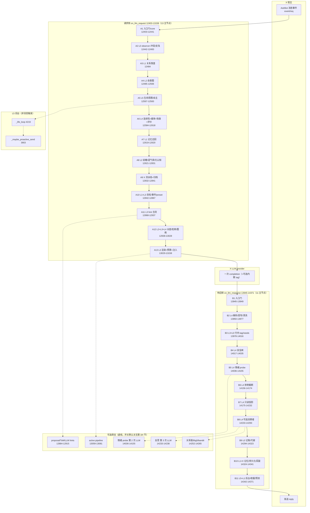

# 一轮消息的完整链路（TURN-PIPELINE）

> **task-170** ｜ 只读文档，不改代码 ｜ 基准：main.py 14385 行（v1.4.15，2026-11-02）
> 行号会随提交漂移；文末「行号刷新」给出复核命令。
> 分层口径：**L0 生物 / L1 记忆·关系 / L2 模型·自我 / L3 解释 / L4 表达·反馈 / L5 自主·交互 / X 宿主·IO**。

## 0. 读法

- **主路只有一条**：AstrBot filter.on_llm_request → BioCore 请求侧 → LLM → filter.on_llm_response → BioCore 响应侧。
- 标「**可选**」的是旁支：开关关闭时整段跳过，主路不受影响；开关名与默认值写在各节点里。
- 节点按「逻辑节点」归并（一个节点内部可能含 1–4 个连续代码块），行号仍是真实行号区间。
- 请求侧 **13 个主节点**、响应侧 **11 个主节点**，均未超过 15；可选旁支单独成表（第 3、5 节）。

## 1. 主路 · 请求侧（on_llm_request，12403-13158）

| # | 层 | 节点 | main.py 行号 | 输入 | 输出 / 副作用 | 可选 |
|---|---|---|---|---|---|---|
| A1 | X | 入口门 + profile/core + 信任种子 | 12403-12441 | event / req | core（内存态）、user_data 前置、日志 | 策略 Q 回写（12413-12433，_policy_pending）默认无待回写 |
| A2 | L0 | 文本抽取 + core.observe + 冲突/反刍/身份威胁 | 12442-12483 | text / _query_vec | v/a/stress/labels、conflict_ema、rumination_ema、boundary_pressure | 嵌入查询 memory_dedup_embedding（默认开，只读召回用） |
| A3 | L1 | 关系落盘 _touch_user | 12484 | event、core | user_data（last_seen/absence/trust/relationship） | — |
| A4 | L2 | 自我层 · 本轮意图 self_intent.evaluate | 12485-12566 | 快照+关系+needs+probe 对方估计+沉默 | core.self_intent/self_motivation/self_initiative/self_length_scale + 一行日志 | self_intent_enabled（默认 **true**） |
| A5 | L5 | 生命周期循环 + 自主就绪 | 12567-12583 | core、user_data | 后台任务、proactive_autonomy 就绪度 | proactive_autonomy / autonomy_loop_enabled（默认 **false**） |
| A6 | L4 | 连续性 + 媒体 + 饱食度 + 用户即时评价 | 12584-12618 | event、core、user_data | _continuity、_img、_voice、_last_insult_ts、accumulator V | 图片/语音按各自开关；情绪即时评价只做 insult 冷却 |
| A7 | L1 | 记忆召回 _memory_recall | 12619-12620 | text、_query_vec、_img、_voice | _mem、_last_memory_meta、_last_memory_trace | 召回策略/后端由记忆层开关决定 |
| A8 | L2 | 自我层批处理：prospective / voice_bank / metacog | 12621-12831 | 上轮 _last_memory_meta、关系、intero、数据文件 | core.pending_prompts、core.voice_phrases、core.metacog、core.self_length_scale（min 0.5–1.5）、三条 hint | 三开关默认 **true**：prospective_enabled / voice_bank_enabled / metacog_enabled |
| A9 | X | 回复流水线观察 + 异步归档 | 12832-12841 | 本次 turn 上下文 | runtime.run_reply 只观察；归档任务 | 归档 create_task（失败静默） |
| A10 | L1+L3 | 目标绑定 + 事件上下文 + preset 组装 | 12842-12867 | _mem、self_model、事件 | core.goal_*、_events、_events_raw、req.contexts 注入 | _preset_enabled()（默认 true）；关闭走 _legacy_context_blocks 12859 |
| A11 | L3 | hint 合流：策略 / ToM / proposal / 自我层 | 12868-12937 | _events_raw、_last_memory_meta、三条自我层 hint | _strategy_hint、_last_strategy_hint、workspace token | LLM 提示 _maybe_llm_hints（功能级开关默认关）；tom_probe、proposal 各功能默认关 |
| A12 | L2+L3+L4 | 长度约束 + bandit/expression/KB/图例 | 12938-13028 | core.self_length_scale、_strategy_hint、text | _brevity（short/medium/normal）、_strategy_hint 截断、KB 文本、bc_text_legend | refusal_brevity_enabled、learning_bandit_enabled、expression_chain_enabled、kb_enabled（均默认 **false**）；bc_prompt_mode==text 才有图例 |
| A13 | L3+X | render_compact →（可选）active pipeline → 预算/去重/state tag → _attach_compact | 13029-13158 | _render_args/_render_kwargs | 注入 req.extra_user_content_parts 的单个 [BC] 块 | bc_budget_enabled（默认 true）、pipeline_mode==active（默认 shadow）、inline_state_tag_enabled（默认 true） |

> 主路请求侧到此结束；之后由 AstrBot 调 LLM provider（X）。

## 2. 主路 · 响应侧（on_llm_response，13945-14371）

| # | 层 | 节点 | main.py 行号 | 输入 | 输出 / 副作用 | 可选 |
|---|---|---|---|---|---|---|
| B1 | X | 入口门 | 13945-13949 | event、response | core、_reply | enabled（默认 true） |
| B2 | L4 | 解析 + 情绪回写 + 反馈 + 清洗 | 13950-13977 | completion_text | core.apply_affect、feedback_flow、response.completion_text 清洗 | —（未知标签丢弃该次 affect，但文本仍清洗） |
| B3 | L3+L0 | 行内 state tag 解析 + needs 事件 | 13978-14016 | _reply | _inline、_store_probe_outputs、_apply_needs_events、图摄取 | inline_state_tag_enabled（默认 true） |
| B4 | L4 | 安全闸（边界/危机/总开关） | 14017-14035 | 用户文本 + _reply | 改写后的 _reply | boundary_enabled / crisis_safety_enabled / safety_enabled（默认 **false**） |
| B5 | L4 | 情绪 probe（第二条 LLM 调用，异步） | 14036-14155 | 用户文本 + _reply | appraisal dims、needs、feedback、状态增量 | emotion_probe_enabled（默认 true）；inline tag 命中时跳过 |
| B6 | L4 | 拒绝姿态句界截断 | 14156-14174 | _reply、refusal posture | 截断后的 completion_text | refusal_brevity_enabled（默认 **false**） |
| B7 | L4 | 只读投影：一致性 / token / 反向检查 / 复读 | 14175-14232 | _reply、历史 | core.reply_consistency、_last_reverse_check、_reverse_check_hint、_repeat_hint | reply_consistency_enabled(false)、token_usage_enabled(false)；反向检查 trace 默认 **true**、hint 默认 **false**；think_repeat_guard_enabled(false) |
| B8 | L4 | 可选消费者：反思 / 迎合 / 关系链 / token 预算 / 路径 | 14233-14293 | _reply、core | _maybe_think_reflect、core.sycophancy_check、core.relationship_dynamics、token 账本、core.path_monitor | think_reflect_enabled(false，含第 3 次 LLM)、sycophancy_check_enabled(**true** 只读)、relationship_chain_enabled(false)、token_budget_enabled(**true** 只读)、path_monitor_enabled(false) |
| B9 | L0 | 回复记账 + 代谢 | 14294-14323 | _reply、_meta | core.record_reply、homeostasis.metabolize_reply、_recent_replies | — |
| B10 | L1+X | 异步记忆 + 状态持久化 + 回滚快照 | 14324-14341 | _reply、core | _remember task、STATE_DIR/*.json、_push_rollback_snapshot | 记忆写入失败静默；回滚快照 ring 10 |
| B11 | L5+L1 | 后台提案 + 本轮记忆收据 + 预测误差 | 14342-14371 | 本轮上下文 | 后台 create_task、_last_turn_memory、_predictive_cycle | 三个提案任务受功能开关+冷却约束（默认关） |

> 响应侧结束后回到 AstrBot 发送。主路响应侧 11 个节点。

## 3. 请求侧可选旁支（开关 → 行号）

| 旁支 | main.py | 开关 / 默认 |
|---|---|---|
| 策略 Q 学习回写 | 12413-12433 | _policy_pending（有 pending 才执行） |
| 自主/生命周期 | 12567-12583 | proactive_autonomy / autonomy_loop_enabled（false） |
| 图片 / 语音上下文 | 12595-12596 | 各自媒体开关（_image_context 8124 起、_voice_context 8098） |
| 情绪即时评价 | 12612-12618 | 只做 insult 冷却（lexical_fallback_enabled 默认 false） |
| 自我层三条 hint | 12916-12928 | prospective_enabled / voice_bank_enabled / metacog_enabled（true） |
| workspace token | 12929-12937 | autonomy_loop_enabled（false） |
| 拒绝姿态 brevity 覆盖 | 12952-12959 | refusal_brevity_enabled（false） |
| bandit / expression / KB | 12960-13013 | 三个对应开关（false）；KB kb_enabled |
| 文本图例 | 13014-13028 | bc_text_legend_enabled + bc_prompt_mode==text |
| active pipeline 接管 | 13059-13081 | pipeline_mode==active（默认 shadow） |
| 预算/去重 | 13090-13134 | bc_budget_enabled / bc_dedupe_enabled（true） |
| 行内 state tag 指令 | 13144-13153 | inline_state_tag_enabled（true） |

## 4. 响应侧可选旁支（开关 → 行号）

| 旁支 | main.py | 开关 / 默认 |
|---|---|---|
| 安全闸 | 14017-14035 | 三开关 false |
| 情绪 probe（第 2 次 LLM） | 14036-14155 | emotion_probe_enabled（true） |
| 拒绝截断 | 14156-14174 | refusal_brevity_enabled（false） |
| 一致性 / token 投影 | 14175-14197 | false |
| 反向检查 trace/hint | 14198-14217 | trace true / hint false |
| 复读守卫 | 14218-14232 | think_repeat_guard_enabled（false） |
| 触发式反思（第 3 次 LLM） | 14233-14238 | think_reflect_enabled（false） |
| 迎合检测 | 14239-14251 | sycophancy_check_enabled（true，只读） |
| 关系链 / Big5 / bandit | 14252-14265 | 各自 false |
| token 预算账本 | 14266-14281 | token_budget_enabled（true，只读） |
| 路径依赖监控 | 14282-14293 | path_monitor_enabled（false） |
| 后台提案（关系印象/日记/叙事） | 14342-14346 | 三功能开关 + 冷却（默认关） |

## 5. 另一条入口：L5 后台自主循环（不是消息触发）

| 入口 | main.py | 说明 |
|---|---|---|
| _life_loop | 4219 | 常驻循环；_ensure_life_task() 12570 首次消息保证启动 |
| _maybe_proactive_send | 3903 | 私聊主动发送；调用点 4372；受 proactive_send/proactive_autonomy 与前文 _autonomy_gate 约束 |
| _update_autonomy_readiness | 3790 | 就绪度写入 core.proactive_autonomy / autonomy_loop |
| _seed_trust_from_user | 3745 | 首轮信任种子（请求侧 A1 调用） |

## 6. Mermaid 流程图



## 7. 节点数与合并建议

请求侧 13 个主节点、响应侧 11 个主节点（均 ≤15）。**可选旁支展开后会超过 15 个**，建议按下面四处合并（只改组织方式，不改行为）：

1. **提示消费总线（请求侧 A11 区，12877-13028，7 段 try/except → 1 段）**：当前 strategy / ToM / proposal / 自我层三条 / expression_chain / repeat+reflect / F1 各占一段，合计 9 个可选消费者。建议合并为 HintBus.collect()：一次收集、一次 combine_strategy_hint，节点 9→2。
2. **响应后处理管线（响应侧 B7+B8，14175-14293，8 段 → 1 段）**：consistency / token_usage / reverse_check / repeat_guard / sycophancy / relationship_chain / token_budget / path_monitor 互不依赖，建议 PostResponseProjections.run(core, reply) 顺序跑，节点 8→1。
3. **回合输入准备（A6 区，12584-12618）**：continuity / image / voice / satiety / user_appraisal 可合并为 TurnInputs.prepare(event, core)，节点 5→1。
4. **后台提案（B11 区，14342-14371）**：关系印象 / 日记 / 关系叙事 → BackgroundJobs.apply() 一次调度，节点 3→1。

合并后主路可压到 **请求 8 + 响应 7 = 15 个节点**，仍在可读范围；本次不改代码，仅登记建议。

## 8. 行号刷新（提交后复核）

```powershell
cd C:\Users\Administrator\Desktop\deepseek\astrbot_plugin_biocore_standalone
Select-String -Path main.py -Pattern "@filter.on_llm_request|@filter.on_llm_response|task-149/150/151: self-layer turn batch|_strategy_hint = await self._maybe_llm_hints|_attach_compact\(req|_predictive_cycle"
```

对照第 1/2 节表格，行号偏差即为文档需要更新的位置。
